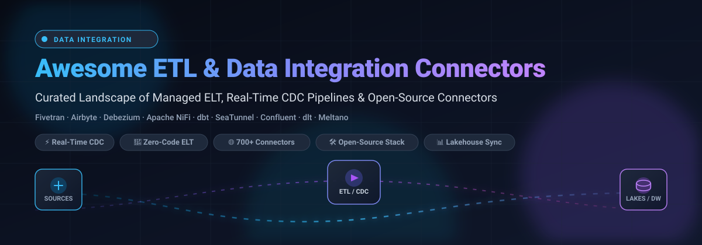
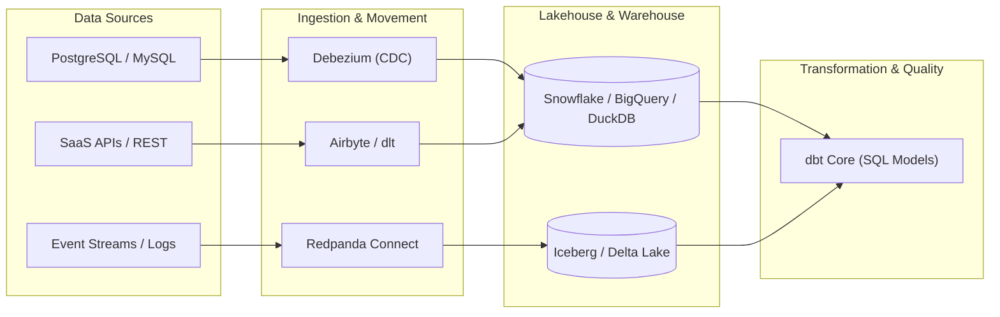

# Awesome Data Integration & ETL Connectors 🚀

  

  
  
  
  
  
  
  

---

**A comprehensive, curated collection of the best SaaS data integration platforms and open-source ETL/ELT pipeline connectors.** 🌟 *Star if you find it helpful!* 🌟

*Covers managed cloud ELT, log-based CDC replication, streaming dataflow engines, and self-hosted open pipeline frameworks.*

📅 **Last updated: November 2026**

---

## 📖 Overview

Modern data stacks require reliable data pipelines to ingest, sync, and transform information across databases, SaaS applications, APIs, lakehouses, and cloud data warehouses. This guide evaluates both enterprise **SaaS data integration platforms** (with 700+ connectors and automated schema drift handling) and battle-tested **open-source frameworks** that give engineering teams total control over infrastructure, security, and costs.

---

## 📑 Table of Contents

- [📊 Sector Overview & Market Dynamics](#-sector-overview--market-dynamics)
- [☁️ SaaS/Hosted Platforms](#️-saashosted-platforms)
- [🐙 Open-Source GitHub Projects](#-open-source-github-projects)
- [🤝 How to Contribute](#-how-to-contribute)
- [💖 Support](#-support)
- [⚠️ Disclaimer](#️-disclaimer)
- [📈 Star History](#-star-history)

---

## 📊 Sector Overview & Market Dynamics

The global data integration and ETL software market is estimated at **$13.1B–$19.1B in 2025** and projected to expand to **$14.3B–$21.5B by 2026** (~10–13% CAGR), driven heavily by enterprise cloud migration, lakehouse unification, and data preparation pipelines for Generative AI applications. 

The sector is **moderately fragmented**: 
- **Hyperscalers & Legacy iPaaS Giants** (Microsoft Fabric/ADF, AWS, Google Cloud Dataflow, Informatica, and IBM) maintain significant governance footprint across Fortune 500 data fabrics.
- **Modern ELT & Open-Source Innovators** (Fivetran, Airbyte, Debezium, dbt, Matillion) capture high-growth cloud-native pipelines, real-time log-based CDC, and modular lakehouse ingestion without creating a single winner-take-all monopoly.

---

## ☁️ SaaS/Hosted Platforms

| Platform | Company Scale (Revenue / Valuation) | Pricing (Specific Starting Tiers) | Free Tier / Free Trial Limits | Description & Key Trade-offs |
| :--- | :--- | :--- | :--- | :--- |
| **[Snowflake Connectors](https://www.snowflake.com/en/developers/downloads/drivers-and-libraries/)** | **~$90B–$115B Market Cap** (~$4.5B+ annual revenue) | Connectors free; Snowflake warehouse compute starts at **Standard tier ~$2.00/credit** (On-demand) | **30-day free trial with $400 in free credits** (trial ends when credits exhaust or 30 days elapse) | Native client libraries (Snowpark, Python, Kafka, Spark). Fast native data transfer into Snowflake, but you must build and orchestrate the pipeline logic yourself. |
| **[Confluent Cloud](https://www.confluent.io/)** | **~$11B Enterprise Value / Market Cap** | Pay-as-you-go connector tasks from **$0.05–$0.10/task-hour** (e.g. S3 source) plus **$0.025/GB** data transfer | **30-day free trial with $400 in usage credits** (ends when credits exhaust or 30 days elapse) | Fully managed Apache Kafka data streaming with 100+ connectors. Best for event streaming pipelines; costs compound across task hours, partitions, and bandwidth. |
| **[Informatica Cloud Data Integration](https://www.informatica.com/)** | **~$7.5B–$8.0B Market Cap** (~$1.6B+ annual revenue) | Integration Cloud pay-as-you-go starts at **¥240,000/month (~$1,600/month)** or **$0.36/IPU-hour** (Informatica Processing Unit) | **30-day free trial** (provisioned evaluation organization with scoped IPU allowance for testing mappings and connectors) | Mature enterprise iPaaS with governance and complex data transformations. Best for large enterprises; steep learning curve and premium pricing. |
| **[Fivetran](https://www.fivetran.com/)** | **$5.6B Valuation** | Free plan up to 500K MAR; Standard plan from **~$500 per million MAR**; **$12,000/year contract minimum**; **$5/month per standard connection** minimum | **Free plan forever up to 500,000 Monthly Active Rows (MAR)**; plus a **14-day unlimited free trial** on paid connectors | Fully managed ELT platform with 700+ connectors, merged with dbt Labs. Deletes and history-mode count toward paid MAR since Jan 2026, increasing high-churn costs. |
| **[Boomi Data Integration](https://boomi.com/)** | **~$4B Valuation** (acquired by Francisco Partners & TPG for $4B) | Pay-As-You-Go starts at **$99/month** (plus $0.05 per processed message); custom enterprise tiers from **$20,000+/year** | **30-day free trial** with full access to Boomi Enterprise Platform integration features (no upfront credit card required) | Low-code cloud-native iPaaS with distributed Atoms runtime. Well-suited for hybrid cloud and SaaS integration; advanced connectors require enterprise contracts. |
| **[Qlik Replicate](https://www.qlik.com/)** | **~$3B–$4B Est. Valuation** (~$750M+ annual revenue; Thoma Bravo owned) | Self-hosted/embedded starting at **$299/month flat rate** (per published entry listings; enterprise quote-based) | **30-day scoped PoC evaluation license** via sales request (license restricted to specified host machines and target endpoints; no public self-service tier) | High-throughput, real-time log-based CDC replication across heterogeneous databases. Best for legacy database sync; custom enterprise pricing required for high scale. |
| **[Airbyte Cloud](https://airbyte.com/)** | **$1.5B Valuation** (Series B) | Standard plan starts at **$20/month**; Plus plan at **$189/month**; Enterprise Flex capacity-based on Data Workers | **Self-hosted Core is 100% free forever**; Airbyte Cloud offers a **14-day free trial with $400 in usage credits** | Managed edition of the leading open-source ELT platform with 700+ connectors. Connector Builder allows fast custom APIs; capacity billing requires sync concurrency planning. |
| **[Matillion (Maia)](https://www.matillion.com/)** | **$1.5B Valuation** (Series E) | Credit-based consumption at **~$2.00 per credit** (Basic model starts at **$500/month** minimum commitment) | **14-day free trial with 500 free credits** (equivalent to ~$1,000 of platform compute) | Low-code pushdown pipeline and transformation platform for Snowflake, Databricks, Redshift, and BigQuery. Streaming CDC bills by clock hour (~1,440 credits/mo), not data volume. |
| **[Hevo Data](https://hevodata.com/)** | **~$100M–$250M Valuation** (~$46M annual revenue) | Free tier up to 1M events/month; Starter plan starts at **$239/month** (billed annually for 5M events/month) or **$299/month** (monthly billing) | **Free plan forever up to 1,000,000 events/month** (unlimited free sources, single destination, 12-hour sync frequency); **14-day free trial** with unlimited events | No-code ELT platform with 150+ pre-built connectors. Transparent, user-friendly entry point for small teams; event quotas deplete quickly on high-frequency streaming. |

---

## 🐙 Open-Source GitHub Projects

Curated open-source projects for self-hosted data integration, log-based CDC replication, and distributed dataflow orchestration. **Sorted descending by GitHub Stars:**

### 1. **[Airbyte (Core)](https://github.com/airbytehq/airbyte)** 
- **Category**: Managed & Self-Hosted ELT Platform (Elastic License 2.0 / MIT connectors)
- **Overview**: The most popular open-source data integration platform with 700+ pre-built connectors. It enables moving data from databases, SaaS apps, and APIs into warehouses, data lakes, and vector stores.
- **Key Features**: No-code AI Connector Builder; Python and low-code CDK; PyAirbyte integration for Python runtime; automated schema drift monitoring.
- **Tech Stack & Deployment**: Java, Python, Docker, Kubernetes.
- **Trade-offs**: Operational overhead for self-hosting; memory overhead on high-concurrency synchronizations.

---

### 2. **[dbt Core](https://github.com/dbt-labs/dbt-core)** 
- **Category**: SQL-Based In-Warehouse Transformation Framework (Apache 2.0)
- **Overview**: The industry standard for post-load transformation ("T" in ELT). Allows analytics teams to write modular SQL `SELECT` queries with software engineering best practices.
- **Key Features**: Automatic DAG dependency resolution; integrated data testing framework; automated data lineage documentation; support for Snowflake, BigQuery, Databricks, Redshift, and DuckDB.
- **Tech Stack & Deployment**: Python, SQL, CLI.
- **Trade-offs**: Handles transformation only—requires pairing with ingestion tools like Airbyte, dlt, or Debezium.

---

### 3. **[Debezium](https://github.com/debezium/debezium)** 
- **Category**: Distributed Log-Based Change Data Capture (Apache 2.0)
- **Overview**: The de facto open-source standard for capturing low-latency row-level database changes without polling overhead.
- **Key Features**: Native transaction log tailing (MySQL binlog, PostgreSQL WAL, MongoDB oplog, Oracle, SQL Server, Db2); Kafka Connect integration; outbox pattern support; exactly-once delivery guarantees.
- **Tech Stack & Deployment**: Java, Apache Kafka, Kafka Connect, Debezium Server.
- **Trade-offs**: Requires operating Apache Kafka or Kafka Connect for production clustering.

---

### 4. **[Apache SeaTunnel](https://github.com/apache/seatunnel)** 
- **Category**: High-Performance Distributed Data Integration Engine (Apache 2.0)
- **Overview**: Next-generation distributed data synchronization engine capable of synchronizing massive volumes of data daily between 100+ connectors across batch and streaming modes.
- **Key Features**: Dedicated SeaTunnel Zeta engine (zero Spark/Flink dependency required, though compatible with both); real-time CDC synchronization; distributed two-phase commit; auto table mapping.
- **Tech Stack & Deployment**: Java, SeaTunnel Zeta Engine, Kubernetes, Docker.
- **Trade-offs**: Steeper configuration curve; community documentation leans heavily toward enterprise clustering.

---

### 5. **[Redpanda Connect (formerly Benthos)](https://github.com/redpanda-data/connect)** 
- **Category**: Stream Processing & Declarative Pipeline Engine (Apache 2.0 / BSL)
- **Overview**: Ultra-lightweight, resilient stream processor and connector tool designed to make stream integration mundane and reliable with single-binary simplicity.
- **Key Features**: 200+ connectors (Kafka, S3, SQL, HTTP, MQTT, NATS, Elasticsearch); declarative YAML pipeline configuration; built-in bloblang mapping language; microsecond latencies with zero dependencies.
- **Tech Stack & Deployment**: Go (single binary), Docker, Kubernetes.
- **Trade-offs**: Best for streaming and event integration rather than heavy bulk table backfills.

---

### 6. **[CloudQuery](https://github.com/cloudquery/cloudquery)** 
- **Category**: High-Performance Cloud Asset & API Extraction ELT (MPL 2.0)
- **Overview**: Pluggable ELT framework written in Go that extracts configuration and metadata from cloud infrastructure, APIs, and SaaS platforms into PostgreSQL, BigQuery, Snowflake, and DuckDB.
- **Key Features**: Concurrent Go gRPC plugin architecture; 70+ official source plugins (AWS, Azure, GCP, GitHub, Okta, Kubernetes); type-safe schema generation; SQL-queryable security and FinOps data.
- **Tech Stack & Deployment**: Go, CLI, Docker.
- **Trade-offs**: Geared heavily toward cloud configurations, compliance, and API metadata ingestion rather than relational database CDC.

---

### 7. **[Apache NiFi](https://github.com/apache/nifi)** 
- **Category**: Visual Dataflow Automation & Edge Ingestion (Apache 2.0)
- **Overview**: Battle-tested graphical platform designed to automate the flow of data between disparate systems with end-to-end data provenance tracking.
- **Key Features**: Drag-and-drop browser UI; 300+ built-in processors; fine-grained backpressure regulation; interactive line-of-custody data provenance; edge distribution with MiNiFi.
- **Tech Stack & Deployment**: Java, Web UI, Standalone / Clustered.
- **Trade-offs**: Heavyweight footprint; requires JVM tuning; less suited for modern git-centric code-driven CI/CD workflows.

---

### 8. **[dlt (data load tool)](https://github.com/dlt-hub/dlt)** 
- **Category**: Python-Native Embedded ELT Library (Apache 2.0)
- **Overview**: An open-source Python library created to load data from messy APIs, files, and SQL databases into data warehouses and data lakes without boilerplate code.
- **Key Features**: `pip install dlt`; automatic schema inference and schema evolution; automatic normalization of nested JSON structures; native support for DuckDB, Snowflake, BigQuery, LanceDB, and Arrow.
- **Tech Stack & Deployment**: Pure Python, embedded in Airflow, Prefect, Dagster, or AWS Lambda.
- **Trade-offs**: Pure library—orchestration, scheduling, and error alerting must be handled by your external workflow orchestrator.

---

### 9. **[Meltano](https://github.com/meltano/meltano)** 
- **Category**: Declarative CLI-First DataOps & ELT Platform (MIT)
- **Overview**: Modular DataOps platform built on the Singer open-source tap/target standard, bringing software development lifecycle practices to data integration.
- **Key Features**: Singer connector ecosystem (hundreds of taps and targets); declarative `meltano.yml` project configuration; native dbt integration; container-ready deployment into any CI/CD or orchestrator.
- **Tech Stack & Deployment**: Python, Singer Specification, Docker, CLI.
- **Trade-offs**: Community Singer tap maintenance can vary in quality across minor SaaS sources.

---

### 10. **[Apache Gobblin](https://github.com/apache/gobblin)** 
- **Category**: Distributed Big Data Integration Framework (Apache 2.0)
- **Overview**: Universal data ingestion and lake ingestion framework created by LinkedIn to unify big data pipelines across Hadoop, cloud storage, and streaming sources.
- **Key Features**: Unified framework for batch and streaming pipelines; built-in compaction and deduplication; enterprise-scale replication between HDFS, S3, ADLS, and Kafka.
- **Tech Stack & Deployment**: Java, Hadoop, Spark, Yarn.
- **Trade-offs**: Heavy big-data infrastructure footprint; complex setup for small-to-medium datasets.

---

### 11. **[Apache Hop](https://github.com/apache/hop)** 
- **Category**: Visual Data Engineering & Orchestration Platform (Apache 2.0)
- **Overview**: Hop Orchestration Platform (forked and completely modernized from Kettle / Pentaho Data Integration) designed for metadata-driven visual ETL and pipeline development.
- **Key Features**: Modern visual UI (Hop GUI); metadata-driven execution architecture; pluggable runtimes (Hop Local, Apache Spark, Apache Flink); integrated Git version control and unit testing.
- **Tech Stack & Deployment**: Java, Desktop GUI / Web GUI, Docker.
- **Trade-offs**: Visual UI-first workflow requires learning Hop's specific pipeline concepts and transform plugins.

---

## 🛠️ Architecture Guide: Building a Production Open-Source Stack

---

## 🤝 How to Contribute

Contributions are warmly welcomed! Help make this curated repository the most actionable reference for data engineers worldwide.

1. 🍴 **Fork** the repository.
2. 🌿 **Create a new branch**: `git checkout -b feature/add-new-connector`.
3. 📝 **Add your entry** under the appropriate section with:
   - Platform / Repository Name with official link
   - GitHub stars badge (for open-source tools: `style=social&color=white`)
   - Company scale / license
   - Factual pricing tier or free tier limits
   - 1–2 sentence description & key trade-offs
4. 🚀 **Submit a Pull Request** with a brief summary of why the addition is valuable.

---

## 💖 Support

If you find this repository helpful for your data architecture, pipeline benchmarking, or connector research:

- ⭐ **Star this repository** on GitHub to support visibility!
- 🍴 **Fork and share** it with fellow data engineers, analytics teams, and architects.
- ☕ **Buy me a coffee / Sponsor**: If this project saved you time evaluating vendors or tools, consider supporting further maintenance on the [GitHub Sponsors Dashboard](https://github.com/sponsors/ishandutta2007)!

  

---

## ⚠️ Disclaimer

- This is a **community-curated** educational guide and does not constitute commercial endorsement.
- **Security & Compliance**: Ingestion pipelines handle sensitive production credentials and regulated records. Ensure encryption in-transit (TLS), secret rotation, and compliance with GDPR, HIPAA, and SOC-2 standards.
- **Architectural Fit**: Choose your stack based on latency requirements (real-time CDC vs. batch hourly ELT), transformation location (in-warehouse SQL vs. engine-level streams), and operating budget.

---

## 📈 Star History

---

  <b>Built with ❤️ for data engineers, analytics teams, and pipeline architects everywhere.</b>

